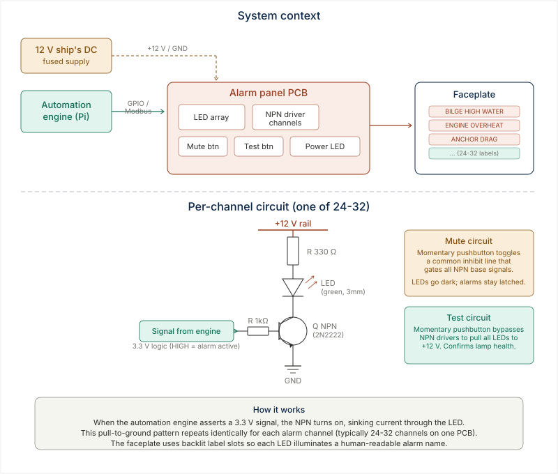

# Alarm Panel

Custom alarm panel PCB for ship's automation systems. Each channel uses an NPN
pull-to-ground driver to light an LED behind a backlit faceplate label. The
automation engine (Raspberry Pi) asserts 3.3 V logic signals; the panel sinks
current through LEDs on a 12 V marine bus.

## Architecture

## What's here

- `registers/` — channel-to-faceplate mapping, BOM, component register
- `EasyEDA/` — schematic and PCB layout project files
- `LICENSE` — MIT

## Key design choices

- **Pull-to-ground NPN** — each channel is identical: base resistor + transistor
  + LED + current limiter. Scale to any channel count.
- **Backlit faceplate** — label slots sit over LEDs so each alarm has a
  human-readable name visible across the cabin.
- **Mute / Test** — momentary buttons for silencing active alarms and confirming
  all LEDs work.
- **No microcontroller on the panel** — the panel is pure hardware driven by the
  automation engine. If the Pi dies, the panel is dark (fail-safe).
